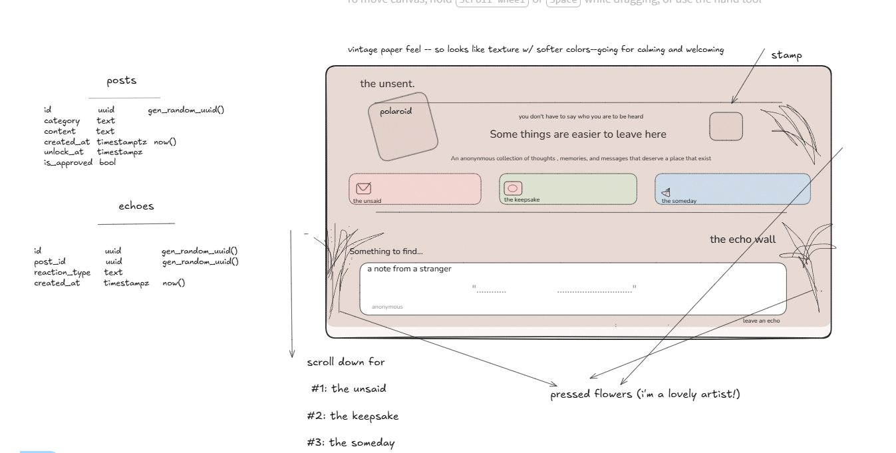

# the unsent.

The Unsent is an anonymous, nostalgia-inspired digital message board where people can share the things they wish they could say, presesrve meaningful memories, and leave messages for their future selves.  

## Features

### Three Themed Spaces

1. The Unsaid: things I wish I could say
2. The Keepsake: moments I want to keep
3. The Someday: notes to my future self

### Signature Feature: Echo Wall

1. A vistor reads an anonymous submission
2. They slect an Echo reaction
3. The reaction is saved to Supabase
4. The original author can see how many people resonated with their message
5. Vistors see the collective response without seeing who reacted

## Target User

Anyone with something to say, and nowhere to say it. Someone who craves connection without the pressure of identity. Someone needing a place to process an emotional event. 

##W ireframe

