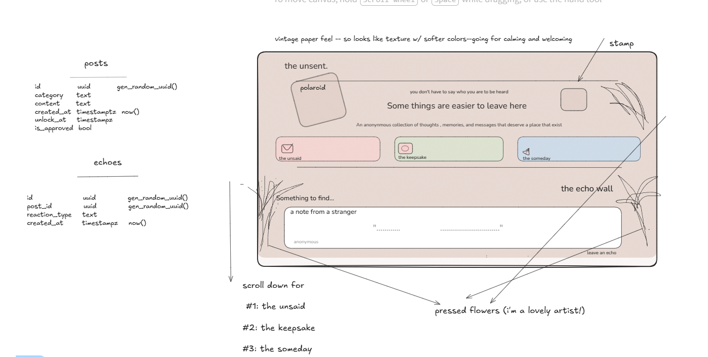

# the unsent.

The Unsent is an anonymous, nostalgia-inspired digital message board where people can share the things they wish they could say, presesrve meaningful memories, and leave messages for their future selves.  

## Features

### Three Themed Spaces

1. The Unsaid: things I wish I could say
2. The Keepsake: moments I want to keep
3. The Someday: notes to my future self

### *Signature Feature: Echo Wall

1. A vistor reads an anonymous submission
2. They select an Echo reaction
3. The reaction is saved to Supabase
4. The original author can see how many people resonated with their message
5. Vistors see the collective response without seeing who reacted

## Target User

Anyone with something to say, and nowhere to say it. Someone who craves connection without the pressure of identity. Someone needing a place to process an emotional event.

## Wireframe

## Attribution

cute flowers on white surface - freepik - magnific.com

## Pod doc

https://docs.google.com/document/d/1mQySxORC2Bp30ZHNkmuCxnYR95Vv0X6jM_2CmppKQQk/edit?usp=sharing

## A note on Anonymity and Care
Please do not post real names, contact details, or other identifying information. Be kind. Many of these messages are personal.
The Unsent is a place for reflection, not a substitute for support. If you are struggling or in crisis, you can call or text 988 (the Suicide & Crisis Lifeline in the US) or contact local emergency services.
